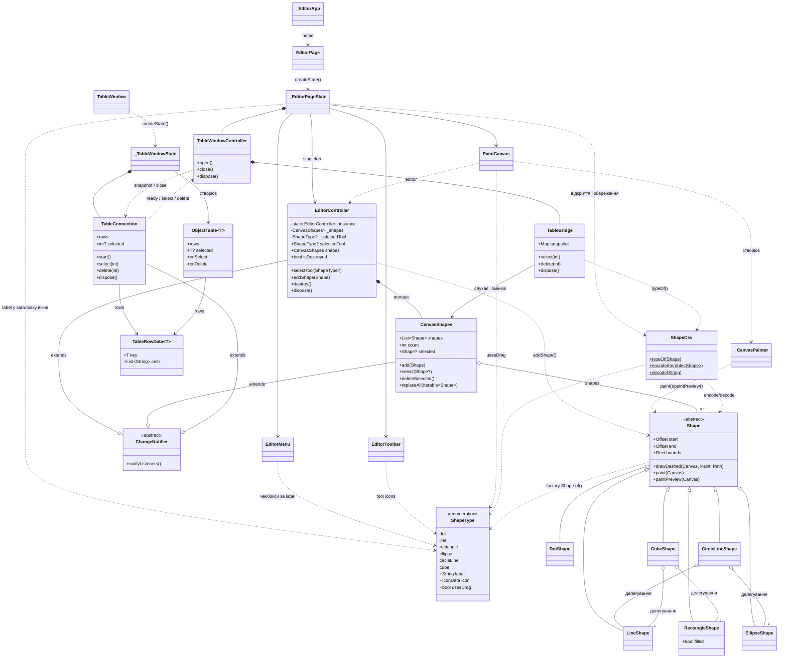

# Лабораторна робота №4. Вдосконалення структури коду графічного редактора об’єктів

Варіант 27 (Ж = Жлаб2 + 1 = 26 + 1 = 27, номер в журналі 26). Простий графічний редактор на Flutter з меню Файл / Довідка та панеллю інструментів (Toolbar).
Крапка ставиться клацанням миші, лінія, прямокутник і еліпс вводяться перетягуванням.
Toolbar з кнопками-іконками та підказками служить для вибору типу об'єкта.

Параметри варіанту:
- масив вказівників Shape: динамічний (27 mod 3 = 0), без обмеження кількості;
- «гумовий» слід: пунктирна лінія чорного кольору (27 mod 4 = 3);
- прямокутник: ввід від центру до одного з кутів (27 mod 2 = 1), чорний контур з кольоровим заповненням (27 mod 5 = 2), колір заповнення — рожевий (27 mod 6 = 3);
- еліпс: ввід по двом протилежним кутам охоплюючого прямокутника (27 mod 2 = 1), чорний контур без заповнення (27 mod 5 = 2);
- позначка поточного типу об'єкта: у заголовку вікна (27 mod 2 = 1), дублюється підсвічуванням кнопки у Toolbar.

Запуск: `flutter run -d linux`

## Діаграма класів

Редактор і таблиця працюють в окремих рушіях Flutter. Пунктирний зв'язок між
`TableWindowController` і `TableConnection` позначає обмін повідомленнями через
`desktop_multi_window`, а не пряме посилання між об'єктами.

