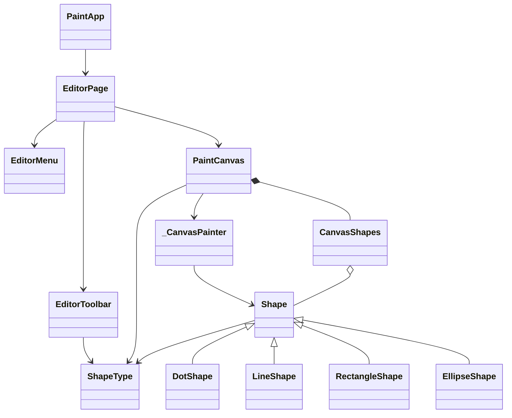

# Лабораторна робота №2. Розробка графічного редактора об'єктів

Варіант 27 (Ж = 27). Простий графічний редактор на Flutter з меню Файл / Довідка та панеллю інструментів (Toolbar).
Крапка ставиться клацанням миші, лінія, прямокутник і еліпс вводяться перетягуванням.
Toolbar з кнопками-іконками та підказками служить для вибору типу об'єкта.

Параметри варіанту:
- масив вказівників Shape: динамічний (27 mod 3 = 0), без обмеження кількості;
- «гумовий» слід: суцільна синя лінія (26 mod 4 = 2);
- прямокутник: ввід по двом протилежним кутам (26 mod 2 = 0), чорний контур з блакитним заповненням (26 mod 5 = 1, 26 mod 6 = 2);
- еліпс: ввід від центру до одного з кутів (26 mod 2 = 0), чорний контур з білим заповненням (26 mod 5 = 1);
- позначка поточного типу об'єкта: у заголовку вікна (27 mod 2 = 1), дублюється підсвічуванням кнопки у Toolbar.

Запуск: `flutter run -d linux`

## Діаграма класів

